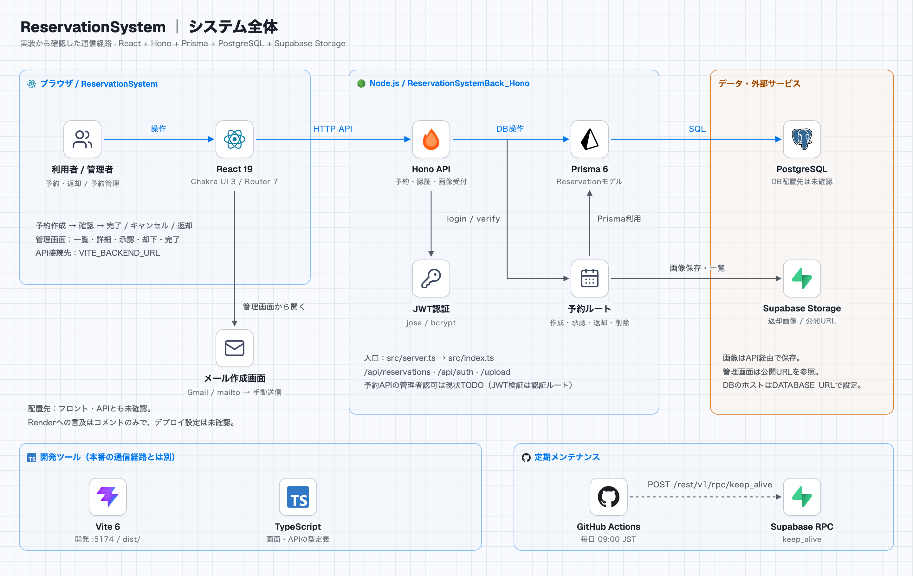
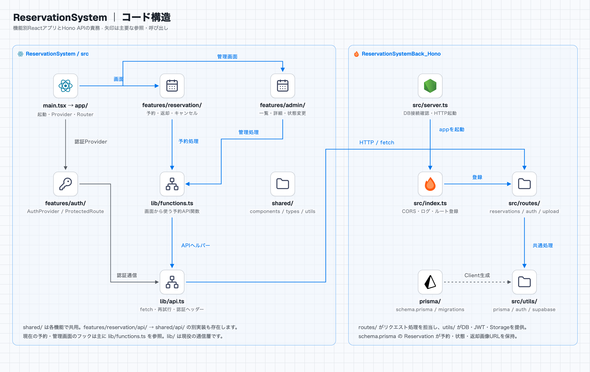

# 予約システム API

Node.js上のHonoで動作する予約システムのバックエンドです。予約データをPrisma経由でPostgreSQLへ保存し、返却画像をSupabase Storageで管理します。

## システム構成

Reactフロントエンドから予約・管理・認証のHTTPリクエストを受け付けます。管理者ログインはjoseとbcryptを使った独自のJWT認証です。

<picture>
  <source media="(prefers-color-scheme: dark)" srcset="docs/architecture/overview-dark.png">
  
</picture>

## コードの構造

`src/server.ts` がDB接続を確認してHTTPサーバーを起動し、`src/index.ts` がCORS・ログ・ルートを設定します。`routes/` が各リクエストを処理し、`utils/` のDB・認証・画像保存用クライアントを利用します。

<picture>
  <source media="(prefers-color-scheme: dark)" srcset="docs/architecture/structure-dark.png">
  
</picture>

[図の根拠・補足・再生成手順](docs/architecture/README.md) · [全体図のHTML](docs/architecture/index.html) · [コード構造のHTML](docs/architecture/structure.html)

HTMLはローカルでブラウザから開くと配色を切り替えられます。GitHub上では上の画像で閲覧できます。図は2026-11-03時点のソースに基づき、デプロイ先など未確認の情報は図中に明記しています。

## ディレクトリ構成

```text
src/
├── server.ts               # DB接続確認・Node.js HTTPサーバー起動
├── index.ts                # Honoアプリ・CORS・ログ・ルート登録
├── routes/
│   ├── reservations.ts     # 予約作成・取得・承認・却下・返却・削除
│   ├── auth.ts             # 管理者ログイン・JWT検証
│   └── upload.ts           # 画像アップロード
└── utils/
    ├── prisma.ts           # Prisma Client
    ├── auth.ts             # パスワード照合・JWT生成/検証
    └── supabase.ts         # Supabaseクライアント・保存バケット設定
prisma/
├── schema.prisma          # Reservationモデル・部屋/状態のenum
└── migrations/            # DBマイグレーション
.github/workflows/
└── keep_alive.yml         # Supabase RPCへの定期リクエスト
docs/architecture/         # 構成図・編集用HTML・再生成手順
```

## 主なAPI

| パス | 役割 |
| --- | --- |
| `/` | サーバーの状態確認 |
| `/api/reservations` | 予約・空き時間用データの取得、作成、状態更新、削除 |
| `/api/auth/login` | 管理者ログインとJWT発行 |
| `/api/auth/verify` | JWTの検証 |
| `/upload` | Supabase Storageへの画像アップロード |

予約APIの管理者認可はソース上TODOです。JWT発行・検証と、予約操作に対する認可は別の処理です。接続上の補足は[構成図の説明](docs/architecture/README.md)にまとめています。

## 技術スタック

- Node.js / TypeScript / Hono 4
- Prisma 6 / PostgreSQL
- Supabase Storage
- jose / bcrypt（管理者認証）
- Zod（リクエスト検証）

バージョンは `package.json` の宣言に基づきます。
